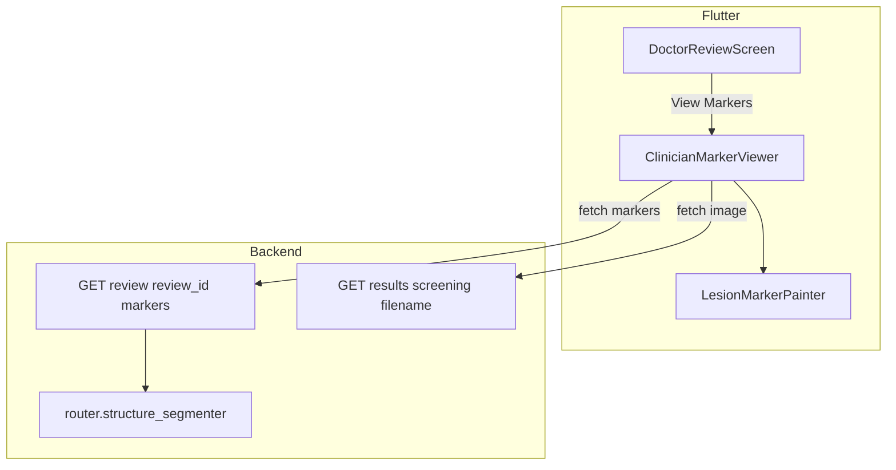
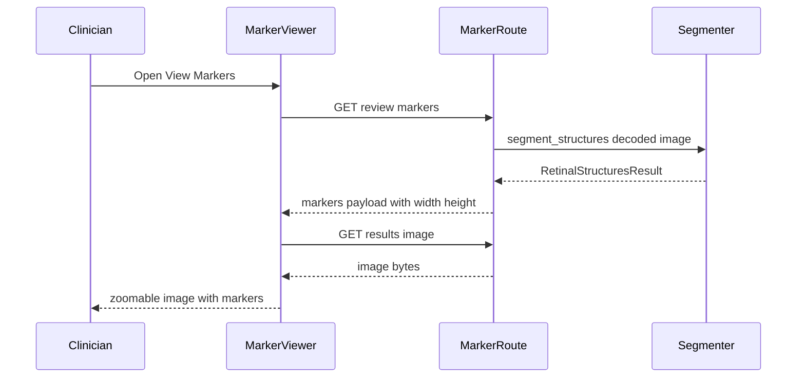

# Design Document — clinician-review-viewer

## Overview

This feature delivers a doctor-facing "what the pipeline found" viewer for the tele-ophthalmologist review flow. A reviewing clinician opens a pending case, sees the real fundus image zoomable to 3.5x, and sees honest anatomical and lesion-candidate markers drawn at their true retinal positions. A drag-to-reveal wipe cross-fades the plain and marked views at identical zoom and pan so the doctor can confirm a marker's true position.

**Users**: tele-ophthalmologists and reviewing clinicians, in the existing `DoctorReviewScreen` queue workflow.

**Impact**: adds one backend route that computes markers on demand, and one Flutter viewer reached from the review case. It does not change grading, thresholds, Grad-CAM, or the operator result screens.

### Goals
- Expose the real coordinates `structure_segmenter.py` already computes — optic disc, fovea, microaneurysm candidates — to the clinician, with honest provenance.
- Compute markers on demand for any review case, including quality-passed cases the BORDERLINE-only path never segmented.
- Provide a zoomable, wipe-inspectable viewer where markers never drift off the anatomy they reference.
- Fail closed and honestly: no image, no markers, or no candidates are each stated plainly and never faked.

### Non-Goals
- Vessel or exudate mask overlays (deferred to keep the payload light).
- Grad-CAM or any model-attention heatmap (owned by `explainability-truthfulness`).
- Editing `results_screen.dart`, `screening_result_screen.dart`, or `flow_result_screen.dart` (owned by `screening-ux-consolidation`).
- Improving segmentation accuracy or thresholds.
- Any change to grading, abstention, or the sign-off decision path.

## Boundary Commitments

### This Spec Owns
- The marker payload contract: coordinates, dimensions, provenance, availability.
- On-demand anatomical/lesion segmentation for a review case, reusing the router's existing segmenter.
- The clinician marker viewer: zoom, marker rendering, drag-to-reveal wipe, unavailable/empty states.
- Wiring a "View Markers" action into `DoctorReviewScreen` only.
- Tests proving coordinate mapping, honesty, and fail-closed behaviour.

### Out of Boundary
- Grad-CAM / model-attention honesty and withholding — `explainability-truthfulness` remains sole owner; this viewer's markers must never be labelled model attention.
- The operator result screens — `screening-ux-consolidation`.
- Vessel/exudate mask overlays and segmentation-accuracy improvements.
- Clinical interpretation of markers; the viewer shows candidates, never diagnoses.
- The sign-off/decision submission path — markers must never block or delay it.

### Allowed Dependencies
- The router's existing `RetinalStructureSegmenter` instance (`router.structure_segmenter`) — reused, not duplicated.
- The existing `GET /results/{screening_id}/{filename}` route to display the image — reused, not re-implemented.
- Existing doctor auth (`require_doctor`) on review routes.
- Flutter primitives: `InteractiveViewer`, `Stack`, `ClipRect`, `CustomPainter`. No new dependencies.

### Revalidation Triggers
- Any change to the `RetinalStructuresResult` coordinate space or units.
- Any change to `original_image_path` storage location or the `GET /results` route contract.
- Any change to review-endpoint authentication or the review→screening join.

## Architecture

### Existing Architecture Analysis

The review queue is text-only today. `GET /review/pending` already joins `screenings` and returns `original_image_url` (`review.py:61,91`), but the Flutter screen discards it. The "View Heatmap" affordance is a dead SnackBar stub (`doctor_review_screen.dart:305-315`).

The segmenter already runs for biomarkers, but its coordinates are collapsed to counts before the client sees them (`ai_bridge.py:311-328`), and it is only invoked on the BORDERLINE quality path (`router.py:163-167`) — so quality-passed review cases have no segmenter output at all.

### Architecture Pattern & Boundary Map



**Architecture Integration**: one-way read path. The viewer fetches markers and the image independently; marker failure never touches the decision path. The backend reuses the existing segmenter singleton and image route rather than adding a parallel implementation.

### Technology Stack

| Layer | Choice / Version | Role in Feature | Notes |
|-------|------------------|-----------------|-------|
| Backend | FastAPI (existing) | Marker route + schema | Reuses `require_doctor`, `get_db` |
| Segmentation | `RetinalStructureSegmenter` (existing) | Compute markers on demand | Reused via `router.structure_segmenter` |
| Frontend | Flutter (existing) | Zoomable wipe viewer | `InteractiveViewer` + `CustomPainter`, no new deps |

## File Structure Plan

### Directory Structure
```
api/
├── routes/review.py          # + GET /review/{review_id}/markers
├── schemas.py                # + ReviewMarkersResponse, Marker schemas
src/
└── services/marker_service.py# NEW: load image + run segmenter + build payload
flutter_app/lib/
├── models/retinal_markers.dart    # NEW: marker model + JSON parsing
├── widgets/review/marker_viewer.dart      # NEW: zoom + wipe viewer
├── widgets/review/lesion_marker_painter.dart # NEW: draws markers in image space
└── screens/doctor_review_screen.dart       # + View Markers action (replaces dead stub)
```

### Modified Files
- `api/routes/review.py` — add the marker GET route; reuse existing auth + screening join.
- `api/schemas.py` — add the marker response schemas.
- `flutter_app/lib/screens/doctor_review_screen.dart` — replace the dead "View Heatmap" SnackBar stub (`:305-315`) with a "View Markers" action that opens the viewer. No other screen touched.

### New Files
- `src/services/marker_service.py` — single responsibility: decode the stored image, run the segmenter, return the payload. Owns fail-closed behaviour.
- `flutter_app/lib/models/retinal_markers.dart` — typed model + `fromJson`.
- `flutter_app/lib/widgets/review/marker_viewer.dart` — the viewer (zoom, wipe, states).
- `flutter_app/lib/widgets/review/lesion_marker_painter.dart` — draws markers in image space.

## System Flows

### Marker fetch + render sequence



Key decision: markers and image load independently. A marker failure shows the image plus an honest unavailable state; it never blocks the doctor from returning to the queue or submitting a decision (Requirement 6.3).

### Wipe and zoom

Plain and marked views are two `Stack` layers sharing one transform, so zoom and pan stay locked by construction. The marked layer is clipped to the wipe fraction. The marker `CustomPainter` sits on top of the marked layer, drawing in source-image space mapped through the shared transform.

## Requirements Traceability

| Requirement | Summary | Components | Interfaces | Flows |
|-------------|---------|------------|------------|-------|
| 1.1-1.4 | On-demand markers, any quality grade, fail closed | marker_service, MarkerRoute | `compute_review_markers` | Marker fetch |
| 2.1-2.4 | Honest payload: coords, dims, provenance, no masks | schemas, marker_service | `ReviewMarkersResponse` | Marker fetch |
| 3.1-3.5 | Zoomable image, markers at true positions, OOB skipped | marker_viewer, lesion_marker_painter | `LesionMarkerPainter` | Render |
| 4.1-4.3 | Drag-to-reveal wipe, layers locked | marker_viewer | wipe transform | Wipe |
| 5.1-5.3 | Honest unavailable / empty states, no decorative overlay | marker_viewer | viewer states | Render |
| 6.1-6.4 | View Markers from review case, never blocks decision | doctor_review_screen | on-open callback | Open viewer |
| 7.1-7.3 | Mapping, honesty, and fail-closed tests; suites green | tests (py + dart) | — | — |

## Components and Interfaces

| Component | Domain/Layer | Intent | Req Coverage | Key Dependencies | Contracts |
|-----------|--------------|--------|--------------|------------------|-----------|
| marker_service | Backend | Decode image, run segmenter, build payload | 1.1-1.4, 2.1-2.4 | segmenter (P0), image decode (P0) | Service |
| MarkerRoute | Backend API | Auth-gated marker endpoint | 1.1, 6.3 | marker_service (P0) | API |
| ReviewMarkersResponse | Backend schema | Marker payload contract | 2.1-2.4 | — | State |
| RetinalMarkers | Flutter model | Typed marker + JSON parsing | 2.1-2.4, 3.1 | — | State |
| LesionMarkerPainter | Flutter widget | Draw markers in image space | 3.1-3.4, 5.1-5.3 | RetinalMarkers (P0) | State |
| ClinicianMarkerViewer | Flutter widget | Zoom + wipe + states | 3.1-3.5, 4.1-4.3, 5.1-5.3 | painter (P0), RetinalMarkers (P0) | State |
| DoctorReviewScreen wiring | Flutter screen | View Markers action | 6.1-6.4 | viewer (P0) | — |

### Backend

#### marker_service

| Field | Detail |
|-------|--------|
| Intent | Decode the stored fundus image, run the segmenter, build the marker payload |
| Requirements | 1.1-1.4, 2.1-2.4 |

**Responsibilities & Constraints**
- Load the review's image from `screenings.original_image_path` using the same capped decode the router uses.
- Run `router.structure_segmenter.segment_structures(np_img)`.
- Return coordinates in the decoded source image's pixel space, plus source `width`/`height`.
- Fail closed to `available: false` + reason on any error, timeout, or missing image. Never fabricate a marker.

**Dependencies**
- Inbound: MarkerRoute — request handling (P0)
- Outbound: `router.structure_segmenter` — segmentation (P0)
- External: PIL/numpy decode (P0)

**Contracts**: Service [x] / API [ ] / Event [ ] / Batch [ ] / State [ ]

##### Service Interface
```python
def compute_review_markers(review_id: str) -> ReviewMarkersResponse
```
- Preconditions: review exists and is reachable by the caller's role.
- Postconditions: returns a payload that is either `available: true` with coordinates + dimensions, or `available: false` with a reason. Never partial or guessed.
- Invariants: coordinates are within source bounds or the marker is dropped; provenance is always `classical_cv_segmentation`.

#### MarkerRoute

| Field | Detail |
|-------|--------|
| Intent | Auth-gated marker endpoint for a review case |
| Requirements | 1.1, 6.3 |

**Contracts**: API [x]

##### API Contract
| Method | Endpoint | Request | Response | Errors |
|--------|----------|---------|----------|--------|
| GET | /review/{review_id}/markers | path: review_id | ReviewMarkersResponse | 404 unknown review, 401/403 auth |

- Idempotent read; safe to retry.
- A segmentation failure is a 200 with `available: false`, not a 5xx.

### Backend Schemas

#### ReviewMarkersResponse
| Field | Type | Notes |
|-------|------|-------|
| review_id | str | echo |
| available | bool | false on any failure |
| reason | str \| null | why unavailable / empty |
| source | str | always `classical_cv_segmentation` |
| width, height | int | decoded source dimensions |
| optic_disc | {x, y, r} \| null | |
| fovea | {x, y} \| null | |
| ma_candidates | list[{x, y, r}] | explicitly empty list when none |

### Flutter

#### RetinalMarkers (model)

| Field | Detail |
|-------|--------|
| Intent | Typed marker payload + `fromJson` |
| Requirements | 2.1-2.4, 3.1 |

**Responsibilities & Constraints**
- Parse the payload; represent unavailable/empty distinctly (`available=false` vs empty `maCandidates`).
- Hold source `width`/`height` for the mapping transform.

**Contracts**: State [x]

#### LesionMarkerPainter

| Field | Detail |
|-------|--------|
| Intent | Draw markers in source-image space, mapped to the displayed/zoomed rect |
| Requirements | 3.1-3.4, 5.1-5.3 |

**Responsibilities & Constraints**
- Map source `(x, y)` → displayed position through the shared fitted/zoom transform.
- Scale marker radii with zoom.
- Skip any marker whose mapped position falls outside image bounds (3.4).
- Draw optic disc as a circle, fovea as a crosshair, each MA as a ring. Never invent a marker.

**Dependencies**
- Inbound: ClinicianMarkerViewer (P0)
- Outbound: RetinalMarkers (P0)

**Contracts**: State [x]

#### ClinicianMarkerViewer

| Field | Detail |
|-------|--------|
| Intent | Zoomable fundus image + drag-to-reveal wipe + honest states |
| Requirements | 3.1-3.5, 4.1-4.3, 5.1-5.3 |

**Responsibilities & Constraints**
- Fetch markers and image independently; a marker failure still shows the image with an honest unavailable state.
- Plain and marked layers share one transform so zoom/pan stay locked under the wipe.
- No wipe when markers are unavailable (4.3). No decorative overlay in place of markers (5.3).

**Dependencies**
- Inbound: DoctorReviewScreen (P0)
- Outbound: LesionMarkerPainter (P0), RetinalMarkers (P0), ApiService (P0)

**Contracts**: State [x]

**Implementation Notes**
- Integration: opened from the review case's "View Markers" action, replacing the dead SnackBar stub.
- Validation: coordinate mapping unit-tested against known positions across zoom levels.
- Risks: coordinate-space mismatch is the highest risk; mitigated by carrying source `width`/`height` and one shared transform, plus explicit tests.

#### DoctorReviewScreen wiring

| Field | Detail |
|-------|--------|
| Intent | Replace the dead "View Heatmap" stub with a "View Markers" action |
| Requirements | 6.1-6.4 |

**Implementation Notes**
- Integration: swaps the SnackBar stub (`:305-315`) for an action that opens `ClinicianMarkerViewer` for that case.
- Validation: marker load failure never blocks returning to the queue or submitting a decision.
- Risks: none beyond the viewer itself; the decision path is untouched.

## Data Models

### Domain Model
- A review case (1) → one marker payload (1). A payload contains 0..1 optic disc, 0..1 fovea, 0..N microaneurysm candidates.
- Invariant: a payload is either fully available (dimensions + markers) or unavailable with a reason — never a partially-populated marker set.

### Data Contracts & Integration

**API Data Transfer**
- `GET /review/{review_id}/markers` → `ReviewMarkersResponse` (JSON), schema above.
- Image fetched separately via the existing `GET /results/{screening_id}/{filename}`.
- Coordinates are integers in the decoded source image's pixel space; the client maps them through the display transform.

## Error Handling

### Error Strategy
Markers are advisory. Every failure degrades to `available: false` + reason and renders the image alone with an honest state. The decision path is never blocked.

### Error Categories and Responses
- **User errors (4xx)**: unknown review → 404; missing/insufficient auth → 401/403.
- **System errors**: image missing, decode failure, segmentation error, timeout → 200 with `available: false` + reason. Never a 5xx for an advisory failure.
- **Empty result**: segmentation succeeds with no MA candidates → `available: true`, empty `ma_candidates`, reason noting no candidates found.

## Testing Strategy

### Unit Tests
- **marker_service**: returns coordinates + dimensions on a known image; returns `available: false` on missing image, decode error, and segmenter exception (never fabricates).
- **RetinalMarkers.fromJson**: parses a full payload; distinguishes `available: false` from empty `ma_candidates`.
- **LesionMarkerPainter mapping**: a marker at source `(x, y)` maps to the expected displayed position across zoom levels (covers Requirement 3.2, 7.1).

### Integration Tests
- `GET /review/{id}/markers` returns the payload for an existing case; 404 for unknown; 401/403 without a doctor key.
- A quality-passed (non-BORDERLINE) review case still returns markers, proving on-demand computation (Requirement 1.2).

### E2E / UI Tests
- Open View Markers from a review case → image renders with markers; unavailable state renders no markers and no overlay (Requirement 5.1).
- Adjusting the wipe keeps plain and marked layers aligned under zoom/pan (Requirement 4.2).
- A failed marker load leaves the sign-off action usable (Requirement 6.3).

### Performance / Load
- Marker fetch completes within an interactive budget on a typical review image; a slow load degrades to unavailable rather than blocking the decision path.

## Security Considerations
- The marker route reuses `require_doctor`; a review case is only reachable by an authorised role.
- Image serving reuses the existing path-safe `GET /results` route (screening-id regex + filename allowlist + realpath containment) — no new file-serving surface.
- No new secrets, no new network surfaces, no client-supplied file paths.

## Performance & Scalability
- On-demand segmentation reuses the router's warm segmenter singleton, avoiding per-request DL model reload.
- Markers and image load in parallel; neither blocks the decision path.
- Payload is coordinates only (no mask bitmaps) to keep it small for low-connectivity clinic use.
