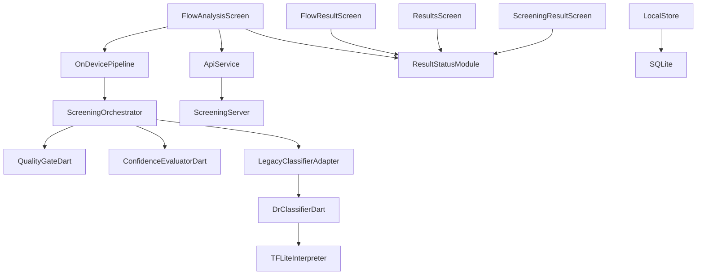
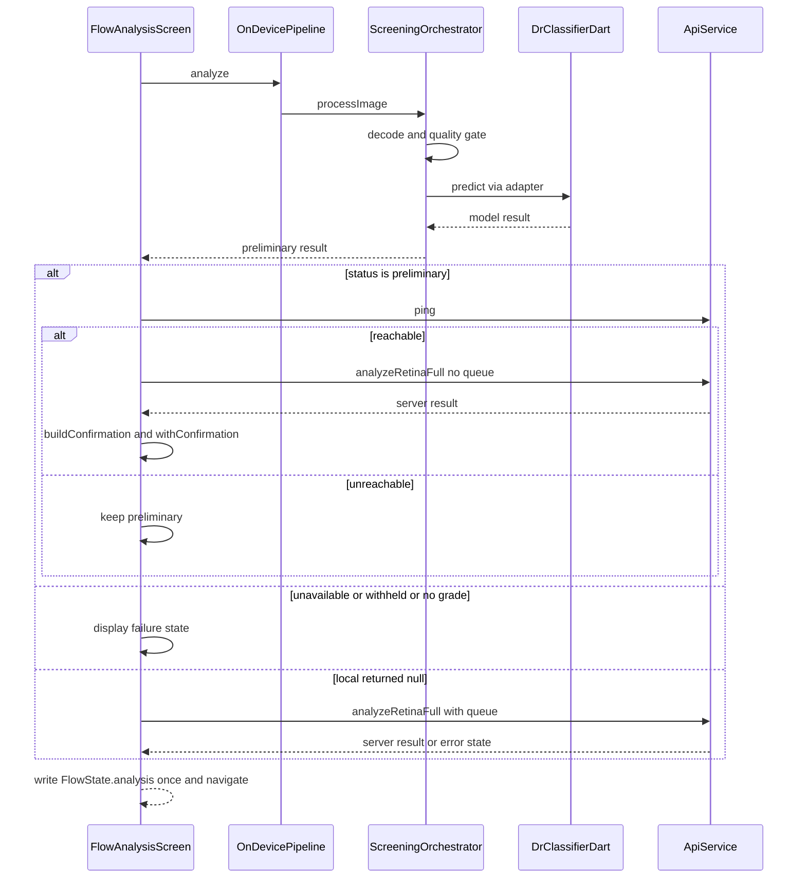
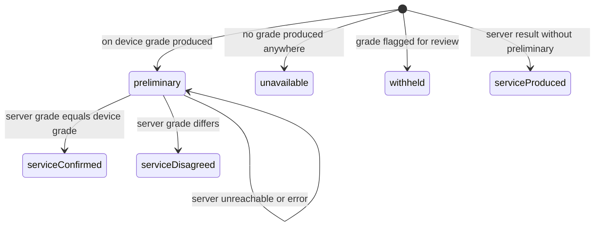

# Design Document — on-device-inference-integrity

## Overview

This feature delivers one guarantee to field operators and clinicians: every preliminary screening grade the Drishti-AI application displays originates from a real, successfully executed device-resident model. It replaces the luminance-heuristic default runner with the already-correct-but-never-constructed `DrClassifierDart`, deletes the fabrication of probability and confidence values, fixes a fail-open initialization bug, and adds an honest provenance surface (canonical backend identity plus a preliminary / service-confirmed / service-produced / unavailable / withheld status derived from actual execution outcomes).

**Users**: field operators (honest failure display, honest backend labels), clinicians (preliminary versus confirmed distinction, preserved disagreement), reviewers/auditors (machine-checked source gate and tests).

**Impact**: changes the live screening path in `flutter_app` from a heuristic-with-fallback architecture to a fail-closed, provenance-carrying pipeline with one inline server-confirmation step. The Python backend is consumed read-only and is not modified.

### Goals

- G1: Every displayed on-device grade is produced by a completed execution of `assets/models/dr_efficientnet_b0_fp32.tflite`; heuristic and hard-coded graders no longer exist (1.1–1.6).
- G2: Loading, initialization, preparation and inference failures render as explicit unavailable/error states; no synthesized value ever reaches a confidence or abstention gate (2.1–2.6, 3.1–3.6).
- G3: Displayed and persisted backend identity equals the backend that ran; preliminary results are labelled preliminary and are confirmed only on genuine server agreement (5.1–5.6, 6.1–6.7).
- G4: An automated source check plus new unit/integration/widget tests prove the above; the existing baseline (119 pytest + 127 subtests, 57 flutter tests, 0 analyze issues) stays green (8.1–8.7).

### Non-Goals

- Preprocessing, resize, normalisation or quality-threshold changes (`preprocessing-parity`).
- Disagreement resolution policy beyond detecting and preserving a disagreement (`prediction-consensus`).
- Grad-CAM / explainability changes (`explainability-truthfulness`).
- Durable record storage, offline queue mechanics, confirmation retry, retention (`offline-record-durability`, `sync-reliability`).
- Model retraining, quantization, architecture change; any new or changed clinical threshold (Requirement 9).
- Consolidating the four duplicated label-derivation sites across screens (`screening-ux-consolidation`); this spec makes each site truthful, not identical.

## Boundary Commitments

### This Spec Owns

- Provenance of the on-device grade: the runner construction sites, the `DrModelOutput` contract, and the identity string attached to every result produced by the device path.
- Fail-closed behaviour of `OnDevicePipeline` / `ScreeningOrchestrator` for loading, initialization, image preparation and inference failure, including the `ensureReady()` fail-open defect.
- Absence of synthesized values: the fabrication block at `screening_orchestrator.dart:224-237` and every hard-coded grader.
- The new status vocabulary: `ScreeningResultStatus`, `ServiceConfirmation`, their derivation and merge rules, and the fields `resultStatus` / `confirmation` on `ScreeningAnalysisModel`.
- One inline confirmation request against the existing screening-analysis capability, gated by connectivity, that never upgrades status on failure.
- Accuracy of backend identity and status wherever this spec writes them (display models and the `recordScreening` signature/column).
- Backend-label and status rendering fixes in the four result-reading screens, including the unknown fallback.
- The tests and the CI source check that verify all of the above.

### Out of Boundary

- Preprocessing algorithms, resize/normalisation behaviour, quality thresholds — `preprocessing-parity`.
- Deciding how to resolve a disagreement once detected — `prediction-consensus` (this spec only prevents a disagreement from being reported as confirmation).
- Automatic re-confirmation, retry/backoff, queueing and persistence lifecycle — `sync-reliability`, `offline-record-durability`.
- Explainability, Grad-CAM, model artifacts, training, quantization.
- Any threshold, calibration or clinical-claim change (Requirement 9): the frozen constants are listed in Error Handling.
- Server API changes, doctor-review workflow, dashboard status vocabulary, i18n copy overhaul.
- Whether the app starts persisting on-device results (decision D6: it does not).

### Allowed Dependencies

- `flutter_litert` ^3.8.0 (resolved 3.9.3, Apache-2.0) — TFLite interpreter; already in `pubspec.yaml:44`.
- `package:image` — decode/resize inside the existing adapter (logic unchanged).
- Existing `ApiService` contract: `ping()` (`api_service.dart:103`) and `POST /retinal/analyze` with `X-API-Key` auth over HTTPS (`retinal.py:104-111`, `_requireHttps` at `api_service.dart:77`).
- Existing gate components read-only in behaviour: `QualityGateDart`, `ConfidenceEvaluatorDart`, all constants in `quality_thresholds.dart`.
- Existing display vocabulary: `FigmaStatus` / `FigmaColors`, existing `errorCode` strings (`aiUnavailable`, `aiLowConfidence`, `imgUntgradable`, `imgInvalid`).
- Repo-root fixtures `../test_samples/...` from `flutter_app/test/` (proven idiom); GitHub Actions flutter job.
- **Forbidden**: any new pub dependency, any threshold edit, any server-side change, any file outside the File Structure Plan.

### Revalidation Triggers

- `DrModelOutput` field nullability or semantics change → runner contract, orchestrator and all fake-runner tests.
- Canonical backend string `'tflite-fp32'` or `'unknown'` changes → four screens, `local_store`, `pipeline_schema`.
- `ScreeningAnalysisModel` constructor/`fromJson` shape changes → `api_service.dart:697`, `on_device_pipeline.dart:127`, dashboard mapping.
- `buildConfirmation()` agreement rule changes → `prediction-consensus` (it consumes this seam) and status tests.
- `local_store` schema version bump → `offline-record-durability`.
- CI gate pattern changes → `ci.yml` flutter job and the source-check test expectations.
- `analyzeRetinaFull` signature change → `flow_analysis_screen` confirmation step.

## Architecture

### Existing Architecture Analysis

- Layering is **screens → services → models**, with screens instantiating services directly (no DI container): `flow_analysis_screen.dart:36-37`. The design therefore places its test seams at the composition root (optional constructor parameters), not in a new architecture layer.
- The live path short-circuits: `local != null` skips the server (`flow_analysis_screen.dart:104-111`); only one source ever fills `FlowState.analysis` (`:161`).
- Two default-runner construction sites hard-wire the heuristic: `on_device_pipeline.dart:17` and `screening_orchestrator.dart:63`.
- Result screens re-derive UI state from `(drGrade, errorCode, modelBackend, isReferable)` — no status field exists anywhere.
- Preserved strengths: the fail-closed quality/domain block (`screening_orchestrator.dart:86-221`), validation (`pipeline_schema.dart:153-173`), DI seams on both ML classes, the working-but-unwired `DrClassifierDart`.

### Architecture Pattern & Boundary Map



**Architecture Integration**
- Selected pattern: layered services with fail-closed sequential pipeline and a single inline confirmation step; test seams injected at the composition root (constructor parameters), consistent with the existing direct-instantiation style.
- Domain boundaries: ML layer (`services/ml/`) owns grade production and fail-closed semantics; models layer (`models/`) owns the status vocabulary and pure derivation/merge logic; screens own sequencing and rendering only; `ApiService` owns transport.
- Existing patterns preserved: gate-before-inference order, error-code vocabulary, `FlowState` hand-off, offline-first order (device → server), no-mock test style, CI grep-gate style.
- New components rationale: `result_status.dart` is new because no field or type anywhere holds R5/R6 data (gap analysis §2); everything else is extension of existing components.
- Steering compliance: core steering files are absent; design follows discovery-recorded conventions instead (few small files, no new dependencies, immutability for model transformations, no hardcoded secrets).

**Decisions register** (full rationale in `research.md` §9): D1 canonical id `'tflite-fp32'` / `'unknown'`; D2 status enum with six values incl. `serviceProduced`; D3 `ensureReady` success-only memoization; D4 referable semantics unchanged, confirmation compares `dr_grade` only; D5 `uncertainty > 0.4` frozen; D6 no new persistence behaviour, accuracy-only writer changes; D7 single inline confirmation attempt; D8 `queueOffline: false` for confirmation; D9 composition-root test seams; D10 mapping of R8.5 state names to enum values; D11 preliminary renders the existing awaiting-specialist badge.

### Technology Stack

| Layer | Choice / Version | Role in Feature | Notes |
|-------|------------------|-----------------|-------|
| Frontend | Flutter / Dart (existing SDK) | All production changes | No version change; `flutter analyze` must stay 0 |
| ML runtime | `flutter_litert` ^3.8.0 (3.9.3) | Real TFLite inference via `DrClassifierDart` | Already declared; no new dependency |
| Imaging | `package:image` (existing) | Decode + 224 bicubic resize in adapter | Preprocessing logic unchanged (out of boundary) |
| Services | `ApiService` (existing) | `ping()` probe + confirmation call | One new optional parameter `queueOffline` (default `true`) |
| Data | SQLite via `db/local_store.dart` | Accuracy of stored backend/status | Additive nullable column, schema version +1 |
| Backend | FastAPI (read-only consumer) | `POST /retinal/analyze` confirmation | **Not modified** |
| CI | GitHub Actions flutter job | New banned-pattern grep-gate + existing test steps | One new step after `ci.yml:114` |

## File Structure Plan

> Working-tree preservation (7.2, 7.5, 7.6): staged, unstaged and untracked work must survive this change; no commit, reset, clean or stash without explicit human permission; if a required edit would overwrite existing work, stop and ask. The list below is the complete confinement set (7.4) — anything not listed stays unmodified.

### Directory Structure
```
repo root/
├── .github/workflows/ci.yml            # +1 grep-gate step in flutter job
└── flutter_app/
    ├── lib/
    │   ├── models/
    │   │   ├── result_status.dart      # NEW: enum, ServiceConfirmation, pure derive/merge
    │   │   └── screening_models.dart   # +resultStatus, +confirmation fields, +withConfirmation
    │   ├── services/
    │   │   ├── api_service.dart        # +status for server results, +queueOffline param
    │   │   ├── db/local_store.dart     # required backend/status params, +result_status column
    │   │   └── ml/
    │   │       ├── model_runner.dart   # DrDetectRunner/BuildARunner DELETED, contract tightened
    │   │       ├── screening_orchestrator.dart  # default runner swap, fabrication block removed
    │   │       ├── on_device_pipeline.dart      # ensureReady fix, status derivation, dispose
    │   │       ├── pipeline_schema.dart         # modelBackend nullable, fromProbabilities factory
    │   │       └── dr_classifier.dart           # _buildResult delegates to factory
    │   └── screens/
    │       ├── flow/
    │       │   ├── flow_analysis_screen.dart    # confirmation step, injectable seams, dispose
    │       │   ├── flow_result_screen.dart      # unknown-backend fallback, status badge
    │       │   ├── flow_capture_screen.dart     # pipeline dispose
    │       │   └── flow_referral_screen.dart    # unknown-backend fallback
    │       ├── results_screen.dart              # unknown-backend fallback, status badge
    │       └── screening_result_screen.dart     # unknown-backend fallback, status badge
    └── test/                                    # NEW files only; existing 57 tests untouched
        ├── dr_classifier_test.dart
        ├── screening_orchestrator_test.dart
        ├── on_device_pipeline_test.dart
        ├── local_store_test.dart
        ├── result_status_test.dart
        ├── result_confirmation_test.dart
        ├── screening_path_integration_test.dart
        ├── flow_analysis_screen_test.dart
        └── result_rendering_test.dart
```

### Modified Files

- `model_runner.dart` — delete `DrDetectRunner` (lines 43-169) and `BuildARunner` (171-222) and the unused `dart:math` import; make `DrModelOutput.probabilities`, `referable`, `uncertainty` non-null; add `toClassificationResult()`; drop `referableScore` if grep confirms no reader (else keep, populated from the real vector).
- `screening_orchestrator.dart` — default runner becomes `LegacyClassifierAdapter(DrClassifierDart())` (`:63`); adapter `modelId` → `'tflite-fp32'` (`:18`); replace fabrication block `:224-239` with `modelOutput.toClassificationResult()`; keep gate order and all threshold expressions byte-identical.
- `on_device_pipeline.dart` — same default-runner swap (`:17`); `ensureReady()` success-only memoization (`:26-35`); `_toAnalysisModel` passes `resultStatus: deriveResultStatus(...)` and nullable `modelBackend`; add `dispose()`.
- `pipeline_schema.dart` — `ScreeningRecordDart.modelBackend` → `String?` default `null` (`:209`); add static `DrClassificationResult.fromProbabilities` (normalise, argmax grade, top-1 confidence, top-1−top-2 margin). **No threshold constant touched.**
- `dr_classifier.dart` — `_buildResult` delegates to the factory; constructor/`Interpreter.fromAsset` untouched (D9).
- `screening_models.dart` — add `ScreeningResultStatus? resultStatus` and `ServiceConfirmation? confirmation` (constructor default `null`, `fromJson` optional keys, immutable `withConfirmation(...)` method that derives the merged status).
- `api_service.dart` — `analyzeRetina`/`analyzeRetinaFull` gain optional `queueOffline` (default `true`); `analyzeRetinaFull` sets `resultStatus` for server-produced results (`serviceProduced` on a real grade, else derived from `errorCode`).
- `flow_analysis_screen.dart` — optional `pipeline`/`api` constructor params defaulting to production instances; confirmation step in `_runAnalysis` (see System Flows); `_onDevice.dispose()` in `dispose()`.
- `flow_result_screen.dart` — `_backendSuffix` null/unrecognised → `'unknown'` (`:43-52`); status badge replaces the hard-coded `FigmaStatus.awaitingSpecialist` (`:125`) with the status-derived badge.
- `results_screen.dart` — unknown-backend fallback at the `modelBackend` mapping (`:170-180`); status badge alongside existing errorCode rendering.
- `screening_result_screen.dart` — same two changes (`:123-132`).
- `flow_referral_screen.dart` — unknown-backend fallback at `:163`.
- `flow_capture_screen.dart` — `_onDevice.dispose()` in `dispose()`.
- `db/local_store.dart` — `recordScreening` modelBackend parameter loses its `'tflite-fp32'` default (required), gains required `resultStatus`; `_schemaVersion` +1 with additive `ALTER TABLE ... ADD COLUMN result_status TEXT NULL` in `_migrate` (guarded, non-destructive); column default `'tflite-fp32'` retained and documented as residual debt.
- `.github/workflows/ci.yml` — new grep-gate step immediately after `:114`, modelled on `:106-114`.

## System Flows

### Confirmation flow (R6, R5, R2)



Key decisions: confirmation runs **only** when `resultStatus == preliminary` (a clean on-device grade); it is a single attempt (D7); a failed attempt, an offline/queued fallback, a server quality rejection or a timeout all leave the model untouched (status stays `preliminary`, R6.4); `queueOffline: false` prevents a confirmation failure from creating a duplicate offline queue entry (D8). The server write happens once, immediately before navigation, so `FlowState.analysis` is never observed in an intermediate state.

### Status state machine (R6, R8.5)



`null` (not shown) is the fifth outcome: quality/decode rejections are not grading results and keep the existing rejection UI. `serviceProduced` covers the local-artifact-unavailable fall-through: the displayed result then carries the server's own backend, satisfying R2.5 (a failed device inference is never reported as on-device or confirmed).

## Requirements Traceability

| Requirement | Summary | Components | Interfaces | Flows |
|---|---|---|---|---|
| 1.1, 1.2, 1.3, 1.4, 1.5, 1.6 | Provenance: real execution only, heuristics deleted, no substitution, grader identity attached | DrModelOutput contract, LegacyClassifierAdapter, ScreeningOrchestrator, CI gate | `DrModelRunner`, `DrModelOutput.toClassificationResult` | Confirmation flow (device leg) |
| 2.1, 2.2, 2.3, 2.4, 2.5, 2.6 | Fail-closed on load/init/prep/inference failure; explicit unavailable; reason preserved | OnDevicePipeline, ScreeningOrchestrator, result screens | `ensureReady`, error-code mapping, `deriveResultStatus` | Confirmation flow (failure branches) |
| 3.1, 3.2, 3.3, 3.4, 3.5, 3.6 | No synthesized values; derivation only from the model vector; uncalibrated output not mislabelled | DrModelOutput, DrClassificationResult.fromProbabilities, ScreeningOrchestrator, CI gate | `toClassificationResult`, `validate()` | Confirmation flow (device leg) |
| 4.1, 4.2, 4.3, 4.4, 4.5, 4.6 | Quality and domain gates unchanged, still ahead of inference, outcomes preserved | ScreeningOrchestrator (untouched gate block), QualityGateDart (untouched) | `QualityGateDart.assess` | Confirmation flow (gate step) |
| 5.1, 5.2, 5.3, 5.4, 5.5, 5.6 | Honest backend identity in display and storage; unknown fallback | LegacyClassifierAdapter, result screens, local_store, ServiceConfirmation | `modelBackend`, canonical id constants | Confirmation flow (backend recording) |
| 6.1, 6.2, 6.3, 6.4, 6.5, 6.6, 6.7 | Preliminary labelling, connectivity-gated confirmation, agreement ⇒ confirmed, failure ⇒ no upgrade, sign-off, disagreement preserved, storage parity | FlowAnalysisScreen, result_status module, ScreeningAnalysisModel | `buildConfirmation`, `withConfirmation`, status badge | Confirmation flow, status state machine |
| 7.1, 7.2, 7.3, 7.4, 7.5, 7.6 | Records and work preserved; additive migration; confined file list; no destructive git operations | File Structure Plan (all changes), local_store migration | — | — |
| 8.1, 8.2, 8.3, 8.4, 8.5, 8.6, 8.7 | Source gate, unit, integration and state-coverage tests, baseline green, honest reporting | CI gate, 9 new test files | — | All |
| 9.1, 9.2, 9.3, 9.4, 9.5, 9.6 | No new threshold, no changed threshold, no clinical claim, unchanged interpretation, unresolved items recorded | ScreeningOrchestrator (frozen constants), quality_thresholds.dart (untouched) | Frozen constant list (Error Handling) | — |

## Components and Interfaces

| Component | Domain/Layer | Intent | Req Coverage | Key Dependencies (P0/P1) | Contracts |
|-----------|--------------|--------|--------------|--------------------------|-----------|
| DrModelOutput / DrModelRunner | ML contract | Typed, non-substitutable runner output | 1, 3 | LegacyClassifierAdapter (P0) | Service |
| LegacyClassifierAdapter | ML | Maps the real TFLite classifier onto the runner seam; canonical id | 1, 5 | DrClassifierDart (P0), DrModelOutput (P0) | Service |
| ScreeningOrchestrator | ML | Fail-closed pipeline, gate order, no fabrication | 1, 2, 3, 4, 9 | QualityGateDart (P0), ConfidenceEvaluatorDart (P0), runner (P0) | Service |
| OnDevicePipeline | ML facade | Honest readiness, model mapping, status at the boundary | 1, 2, 5, 8 | ScreeningOrchestrator (P0) | Service, State |
| result_status module | Models | Status enum, confirmation value, pure derive/merge | 5, 6 | none | State |
| FlowAnalysisScreen | UI | Sequencing incl. one confirmation step; composition root | 2, 6 | OnDevicePipeline (P0), ApiService (P0) | State |
| Result screens (×4) | UI | Truthful backend label + status badge | 5, 6 | result_status (P1) | — |
| ApiService delta | Services | Server-result status; non-queuing confirmation | 5, 6 | server endpoint (P0) | API |
| LocalStore delta | Data | Stored backend/status cannot default to a false value | 5, 7 | SQLite (P0) | State |
| CI source gate | Ops | Banned-pattern check for heuristic/fabrication code | 8, 9 | GitHub Actions flutter job (P0) | — |

### ML Layer

#### DrModelOutput / DrModelRunner contract

| Field | Detail |
|-------|--------|
| Intent | Runner output in which every uncertainty-bearing field is present by type |
| Requirements | 1.1, 1.2, 1.5, 1.6, 3.1, 3.2, 3.3 |

**Responsibilities & Constraints**
- `probabilities`, `referable`, `uncertainty` are **non-nullable** after this change; the only reason they were nullable (the ordinal runner) is deleted, so "value unavailable" can no longer be encoded as `null` and then fabricated downstream.
- `modelId`/`modelVersion` identify the executing grader; the orchestrator copies `modelId` into `ScreeningRecordDart.modelBackend` (`:287`) — provenance is transitive by construction.
- Derivations are pure functions of the model vector; no branch may invent a value.

**Dependencies**
- Inbound: LegacyClassifierAdapter — producer (P0); ScreeningOrchestrator — consumer (P0); test fakes — producer (P1).
- Outbound: DrClassificationResult (P0).

**Contracts**: Service [x] / API [ ] / Event [ ] / Batch [ ] / State [ ]

##### Service Interface

```dart
class DrModelOutput {
  final DrGrade grade;
  final List<double> probabilities;   // required, length 5
  final bool referable;
  final double uncertainty;           // required; adapter derives 1 - top1
  final String modelId;
  final String modelVersion;
  final double inferenceMs;
  DrClassificationResult toClassificationResult();
}

abstract class DrModelRunner {
  String get modelId;
  String get modelVersion;
  Future<void> initialize();
  Future<DrModelOutput> predict(img.Image image);
  void dispose();
}
```

- Preconditions: `predict` is called only after `initialize()` succeeded (enforced by `OnDevicePipeline.ensureReady`).
- Postconditions: if `predict` throws, no `DrModelOutput` exists — the orchestrator's catch produces `aiUnavailable` with `drPrediction == null`.
- Invariants: `toClassificationResult()` yields `confidence == max(probabilities)` and `top2Margin == top1 - top2` (satisfies `validate()`); `probabilities.length == 5`.

**Implementation Notes**
- Integration: only production producer is `LegacyClassifierAdapter`; deleting `DrDetectRunner`/`BuildARunner` makes R1.3/R1.4 a compile-time fact.
- Validation: `DrClassificationResult.validate()` unchanged and still guards NaN/inf/mismatch.
- Risks: if `referableScore` has an unseen reader, removing it breaks compilation — grep before deleting (task-level check).

#### LegacyClassifierAdapter

| Field | Detail |
|-------|--------|
| Intent | Bridge `DrClassifierDart` onto `DrModelRunner`; carries the canonical backend id |
| Requirements | 1.1, 1.6, 5.1 |

**Responsibilities & Constraints**
- `modelId` becomes `'tflite-fp32'` (D1); `modelVersion` stays.
- Resize-to-224 and buffer serialisation at `:28-40` are **byte-for-byte unchanged** — preprocessing is out of boundary.
- `uncertainty := 1 - confidence` where `confidence` is the model's top-1 value; `referable` passes the classifier's `grade.isReferable`.

**Dependencies**: Inbound: ScreeningOrchestrator / OnDevicePipeline (P0). Outbound: DrClassifierDart (P0).

**Contracts**: Service [x]

**Implementation Notes**
- Integration: constructed at the two former `DrDetectRunner()` sites plus tests. Validation: `result_status_test` asserts id. Risks: none beyond the resize contract owned by `preprocessing-parity`.

#### ScreeningOrchestrator

| Field | Detail |
|-------|--------|
| Intent | Fail-closed port of the server pipeline: decode → gate → predict → evaluate |
| Requirements | 1.1–1.6, 2.1–2.6, 3.1–3.4, 4.1–4.6, 9.1–9.4 |

**Responsibilities & Constraints**
- Default runner: `LegacyClassifierAdapter(DrClassifierDart())` (replaces `DrDetectRunner()` at `:63`).
- **Fabrication block `:224-239` deleted**; replaced by `modelOutput.toClassificationResult()`.
- Gate order, `BAD`/`BORDERLINE` branches, exception → `aiUnavailable` mapping, `uncertainty > 0.4`, referable-mass expression, action strings: **unchanged** (R4, R9).
- Fail-closed mapping: predict/preparation throw → `aiUnavailable` record, `drPrediction == null`, `modelBackend == null` (with the field now nullable), reason in `humanReviewReason`/`action` (R2.2, R2.5, R2.6).
- Output-validation failure: `validate()` inside the evaluator already forces `requiresHumanReview` + `isConfident == false` → `aiLowConfidence` → status `withheld` via derivation (R2.4, R3.4). The existing display policy that keeps a referable grade visible as *provisional* is retained (under-referral protection) — the grade is never presented as a valid final prediction.

**Dependencies**
- Inbound: OnDevicePipeline (P0); fakes (P1).
- Outbound: QualityGateDart, ConfidenceEvaluatorDart, DrModelRunner, pipeline_schema (all P0).

**Contracts**: Service [x] / State [x]

##### Service Interface

```dart
Future<ScreeningRecordDart> processImage(
  Uint8List encodedBytes, {
  int recaptureAttemptCount = 0,
});
```

- Preconditions: image bytes present; runner `initialize()` already succeeded.
- Postconditions: exactly one of {quality/decode rejection record, `aiUnavailable` record, graded record} — never both a failure and a grade.
- Invariants: quality gate executes before `predict` for every image; no code path constructs a probability list literal.

**Implementation Notes**
- Integration: unchanged call shape for `OnDevicePipeline`. Validation: orchestrator unit tests with spy runners. Risks: pinned confidence-flag tests (×9) must stay green — threshold expressions untouched.

#### OnDevicePipeline

| Field | Detail |
|-------|--------|
| Intent | Readiness honesty + record→model mapping + status at the device boundary |
| Requirements | 1.1, 2.1, 2.2, 5.4, 6.1, 8.2, 8.4 |

**Responsibilities & Constraints**
- `ensureReady()`: memoize **success only** (D3). On failure return `false` without latching; retries occur only when the operator re-invokes analysis (one init attempt per call — no loop).
- `analyze()` returns `null` only for initialization failure (existing fall-through contract); everything else maps to a model with a derived status.
- `_toAnalysisModel` passes `resultStatus: deriveResultStatus(drGrade: ..., errorCode: ..., serverProduced: false)` and the now-nullable `record.modelBackend`.
- `dispose()` added: delegates through the orchestrator to the runner to `DrClassifierDart.dispose()` (interpreter lifecycle, closes the current never-closed interpreter).

**Dependencies**: Inbound: FlowAnalysisScreen (P0), tests (P0). Outbound: ScreeningOrchestrator, result_status module, screening_models (P0).

**Contracts**: Service [x] / State [x]

##### Service Interface

```dart
Future<bool> ensureReady();
Future<ScreeningAnalysisModel?> analyze({
  required Uint8List imageBytes,
  required String patientId,
  required String eyeSide,
  required String cameraProfile,
  int recaptureAttemptCount = 0,
});
void dispose();
DrModelRunner get modelRunner; // unchanged, used for wiring assertions
```

- Preconditions: bytes decodable by the orchestrator. Postconditions: `null` ⇒ initialization failed and no grade exists anywhere; non-null ⇒ status field is set.
- Invariants: a failed `ensureReady` never reports `true` on a later call without a new successful `initialize()`.

**Implementation Notes**
- Integration: default construction now yields the real classifier chain. Validation: `on_device_pipeline_test` (D3 latch, wiring assertion, failure → no grade). Risks: retry change alters offline behaviour deliberately (R2 requirement).

### Models Layer

#### result_status module (`lib/models/result_status.dart`)

| Field | Detail |
|-------|--------|
| Intent | The one home for R5/R6 vocabulary and rules |
| Requirements | 5.1–5.6, 6.1–6.7, 8.5 |

**Responsibilities & Constraints**
- Owns `ScreeningResultStatus`, `ServiceConfirmation`, `deriveResultStatus()`, `buildConfirmation()`. No I/O, no widget imports (models layer must not import services).

**Dependencies**: Inbound: on_device_pipeline, api_service, flow_analysis_screen, screening_models, all result screens (P0). Outbound: none.

**Contracts**: State [x]

##### State Management

```dart
enum ScreeningResultStatus {
  preliminary,      // clean on-device grade, not confirmed
  serviceConfirmed, // server grade equals device grade
  serviceDisagreed, // server grade differs; both preserved
  serviceProduced,  // server result without any device preliminary
  unavailable,      // no grade produced (device and/or service)
  withheld,         // grade exists but flagged for review
}

class ServiceConfirmation {
  final bool agreed;
  final String? serverBackend;
  final int? serverGrade;
  final String? serverScreeningId;
}

ScreeningResultStatus deriveResultStatus({
  required int? drGrade,
  String? errorCode,
  ServiceConfirmation? confirmation,
  bool serverProduced = false,
});

ServiceConfirmation? buildConfirmation({
  required int preliminaryGrade,
  required ScreeningAnalysisModel serverResult,
});
```

- `deriveResultStatus` precedence: quality/decode codes (`imgInvalid`, `imgUntgradable`) → caller passes `null` status (non-grading); `confirmation.agreed` → `serviceConfirmed`; `confirmation` present → `serviceDisagreed`; `serverProduced && drGrade != null && errorCode == null` → `serviceProduced`; `drGrade == null` → `unavailable`; `errorCode != null` (grade present) → `withheld`; else → `preliminary`.
- `buildConfirmation` returns `null` when the server result has any `errorCode`, `drGrade == null` (incl. `PENDING_SYNC` offline fallback) or `isOffline` — i.e. nothing to agree with. Otherwise returns the value with `agreed == (serverGrade == preliminaryGrade)`.
- Invariants: status is monotonic — only `withConfirmation` moves `preliminary` forward; no failure path can produce `serviceConfirmed` or `serviceProduced` from a device grade.

**Implementation Notes**
- Integration: `ScreeningAnalysisModel.withConfirmation(...)` returns a **new** immutable instance (model transformations stay immutable per project standards). Validation: `result_status_test` + `result_confirmation_test` cover every branch incl. R8.5's four named states (D10 mapping). Risks: none — fields are additive and nullable, no test constructs the model today.

### UI Layer

#### FlowAnalysisScreen

| Field | Detail |
|-------|--------|
| Intent | Composition root and the only place the confirmation step executes |
| Requirements | 2.1, 2.2, 6.1–6.6, 8.4 |

**Responsibilities & Constraints**
- Optional constructor params `{OnDevicePipeline? pipeline, ApiService? api}` default to the current production instances (`:36-37`) — behaviour with no arguments is unchanged (D9).
- `_runAnalysis` sequencing per the confirmation flow diagram: device leg → status check → connectivity probe → single non-queuing confirmation → merge → single `FlowState.analysis` write (`:161`) → navigate.
- Local `null` keeps the existing server fall-through; local non-`preliminary` skips confirmation and renders as-is (failure states are not laundered through the server step).
- `dispose()` disposes the pipeline it owns.

**Dependencies**: Inbound: navigation (P0). Outbound: OnDevicePipeline, ApiService, result_status, FlowResultScreen (P0).

**Contracts**: State [x]

##### State Management
- State model: existing `_result` / `_error` / scanner states — extended only by treating `resultStatus == preliminary` as the confirmation gate.
- Concurrency strategy: confirmation is awaited before navigation (single-owner, no concurrent writes to `FlowState`).

**Implementation Notes**
- Integration: `ApiService` fakes override `ping`/`analyzeRetinaFull` (no mock library required — existing `package:http/testing.dart` precedent). Validation: `flow_analysis_screen_test` (R6.2 called / R6.4 not-upgraded / R8.4 device invocation). Risks: scanner timers in widget tests — use `tester.pump` with bounded durations.

#### Result screens — `flow_result_screen`, `results_screen`, `screening_result_screen`, `flow_referral_screen`

Summary-only (presentation, no new boundaries):
- Backend label: recognised values (`'tflite-fp32'` → existing "on-device" wording, `'simulated'` → existing simulation warning, server ids as-is) render as today; `null`/unrecognised → explicit unknown label (R5.4, R5.6).
- Status badge: derives from `resultStatus` when non-null — `preliminary` → existing `FigmaStatus.awaitingSpecialist` with "awaiting clinician sign-off" copy (R6.5, D11); `serviceConfirmed` → existing verified style + confirmation source line (`serviceConfirmed`/`serviceProduced` show the server backend — R5.3); `serviceDisagreed` → warning style naming both grades (R6.6); `unavailable`/`withheld` → existing error/uncertain rendering (R2.2, R2.4). `null` status keeps today's rendering exactly (historical/quality records — no regression).
- Existing `errorCode`/`isOffline`/`isFromFallback` visual hierarchy takes precedence (offline UX unchanged).
- Score wording (3.5, 3.6): no copy added or modified by this spec labels the normalised score distribution as a probability or a calibrated/clinically validated quantity; display keeps the measured top-1 value shown as confidence, uncalibrated by declaration. Pre-existing wording audits belong to `claims-evidence-fidelity`.

### Services & Data

#### ApiService delta

Summary-only + note:
- `analyzeRetina`/`analyzeRetinaFull` gain `bool queueOffline = true`; the socket-failure branch only enqueues when `true` (D8). Default behaviour for all existing call sites is unchanged.
- `analyzeRetinaFull` sets `resultStatus` on every constructed model: `serverProduced: true` derivation for clean server results, `deriveResultStatus` otherwise (offline/timeout fallbacks → `unavailable`/`withheld`, never `serviceConfirmed`).
- Confirmation precondition failures (404 patient-not-registered, 401, timeout, 5xx) throw or return fallbacks — all handled by the screen's catch → stay `preliminary` (R6.4).

#### LocalStore delta

| Field | Detail |
|-------|--------|
| Intent | Stored backend/status cannot silently default to a false value |
| Requirements | 5.5, 6.7, 7.1, 7.3, 7.4 |

**Responsibilities & Constraints**
- `recordScreening`: `modelBackend` becomes a required named parameter (no `'tflite-fp32'` default at `:210`); new required `resultStatus` parameter stored into the new column.
- Schema: `_schemaVersion` +1; `_migrate` performs additive `ALTER TABLE ... ADD COLUMN result_status TEXT NULL` guarded by a column-existence check — existing rows untouched and readable (R7.1, R7.3).
- `model_backend` column default `'tflite-fp32'` (`:116`) is retained because SQLite cannot alter it non-destructively; the Dart parameter is required, so the default is unreachable from this writer. Recorded as residual debt for `offline-record-durability`.

**Dependencies**: Inbound: (currently zero callers; future `offline-record-durability`). Outbound: SQLite (P0).

**Contracts**: State [x]

**Implementation Notes**
- Integration: writer only — no change to readers, queues or `OfflineQueueService`. Validation: schema test (insert with explicit values, read back; old rows readable). Risks: none at runtime today (zero callers).

#### CI source gate (`.github/workflows/ci.yml`)

| Field | Detail |
|-------|--------|
| Intent | Machine-check that heuristic/fabrication code cannot return to `lib/` |
| Requirements | 8.1, 9.3 (fabrication half) |

**Responsibilities & Constraints**
- New step in the flutter job directly after the privacy gate (`:106-114`), before `flutter analyze` (`:116`), same shape: `VIOLATIONS=$(grep -riE "<patterns>" lib/ || true)`; non-empty → `::error::` + `exit 1`.
- Patterns (banned identifiers/literals only, deliberately narrow to avoid false positives): `DrDetectRunner|BuildARunner|_inferOrdinalRegression|rgRatio|\[0\.70,\s*0\.15,\s*0\.08|0\.90\s*:\s*0\.02|confVal`.
- The gate fires on deleted-class names, the luminance heuristic, the hard-coded probability vector and the fabrication literals. Clinical-claim wording checks belong to `claims-evidence-fidelity` (different pattern set, different owner).

**Dependencies**: Inbound: CI (P0). Outbound: none.
**Contracts**: none (verification step).

## Data Models

### Domain Model

- Aggregates: `ScreeningAnalysisModel` is the result aggregate root carried by `FlowState`; `ServiceConfirmation` is a dependent value object owned by it.
- Invariants: (a) grade ⇒ non-null `modelBackend` from the executing runner, or explicit `unknown`; (b) `serviceConfirmed`/`serviceDisagreed` ⇒ `confirmation != null`; (c) device grade ⇒ at most one forward status transition, made only by `withConfirmation`; (d) quality/decode rejection ⇒ `resultStatus == null`.

### Logical Data Model

- `ScreeningAnalysisModel`: **+ `resultStatus: ScreeningResultStatus?`** (default `null`), **+ `confirmation: ServiceConfirmation?`** (default `null`); `fromJson` reads optional `result_status` and `confirmation` keys (absent on server payloads → `null`, backward compatible); immutable `withConfirmation(ServiceConfirmation)` returns a copy with the merged status.
- `ScreeningRecordDart.modelBackend`: `String` → `String?`, default `null` (quality-gate-only records no longer claim `'tflite-fp32'` — R2.5/R5.4).
- `DrModelOutput`: three fields move from nullable to required (in-app only type; nothing persists it).
- No change to `ScreeningResult` (server DTO) — server payloads are unchanged.

### Physical Data Model

- `local_screenings` table: **+ `result_status TEXT NULL`**; existing `model_backend TEXT NOT NULL DEFAULT 'tflite-fp32'` retained (documented residual). `_schemaVersion` incremented; migration is additive-only.
- Integrity: stored `model_backend`/`result_status` are written from the same values the UI displayed (R5.5, R6.7) because the writer takes them as required parameters from the model instance.
- Temporal: legacy rows have `result_status IS NULL` = "status unknown, pre-dates this spec" — rendered by the existing path, never as `confirmed`.

### Data Contracts & Integration

- Confirmation payload = the existing `RetinalAnalysisResponse` subset: `dr_grade`, `model_backend`, `screening_id`, `is_referable`, `error_code`, `quality_passed`. Client-side confirmation adds no fields to the wire protocol; the server is untouched.
- Agreement rule (client-side): `server.dr_grade == preliminary.dr_grade` (D4) — the server has no agree/disagree concept, and referable semantics are deliberately excluded from the comparison.

## Error Handling

### Error Strategy

Fail closed at the earliest detection point; every failure maps to an existing error code plus a derived status; operator-facing reasons already carried by `humanReviewReason`/`action`/`rejectionReasons` are preserved, never replaced.

### Error Categories and Responses

| Failure | Detection point | Response | Displayed state |
|---|---|---|---|
| Decode / dimension failure | `processImage` `:86-113` | `imgInvalid` record, no inference | rejection UI, `resultStatus == null` |
| Quality BAD / BORDERLINE | gate `:123-200` | recapture / escalate records (unchanged) | rejection UI, `resultStatus == null` |
| Model load / init failure | `DrClassifierDart.initialize` throws `StateError`; `ensureReady` false | `analyze()` → `null`; existing server fall-through | server result (`serviceProduced`) or explicit error state |
| Inference / preparation throw | orchestrator catch `:204-221` | `aiUnavailable`, `drPrediction == null`, `modelBackend == null` | `unavailable` + backend `unknown` (R2.2, R2.5) |
| Output validation failure | `validate()` / evaluator Rule 0 | flags + `requiresHumanReview` + `aiLowConfidence` | `withheld` (grade never final; referable visibility policy retained) |
| Confidence/uncertainty gate | evaluator + `uncertainty > 0.4` (**frozen**) | `aiLowConfidence` | `withheld` |
| Confirmation unreachable / timeout / 4xx / 5xx / queued fallback | `ping` false, `analyzeRetinaFull` throws or returns fallback | no merge | stays `preliminary` (R6.4) |
| Confirmation disagreement | `buildConfirmation` `agreed == false` | merge both sides | `serviceDisagreed` + both grades (R6.6) |

**Frozen constants (R9 — must not change):** `kMinConfidenceThreshold` 0.60, `kMinAmbiguityMargin` 0.15, `kAlwaysFlagHighRisk`, `uncertainty > 0.4`, `kReferableMassThreshold` 0.09, `kMaxRecaptureCap`, every `quality_thresholds.dart` value, `DrGrade.isReferable >= 2`.

### Monitoring

No runtime telemetry is added (offline-first field app). Evidence channel = CI: the new grep-gate, `flutter analyze`, `flutter test`, and the Python suites. Operator-visible error surface remains the existing `errorCode` + `action` + `humanReviewReason` strings.

## Testing Strategy

Test idioms: `package:flutter_test`, single `group`, plain `expect`, hand-rolled fake `DrModelRunner` and fake `ApiService` subclasses (no mock library — repo has none), repo fixtures via `Directory('../test_samples/...')`.

### Unit Tests

- **`dr_classifier_test.dart`** (R2.1, R8.2): `initialize()` with bogus `assetPath` throws `StateError` and leaves `isReady == false`; `classify()` before init throws `StateError`; wrong buffer length throws `ArgumentError`; `fromProbabilities` rejects malformed vectors — proves failure paths cannot yield a grade.
- **`result_status_test.dart`** (R5.4, R5.6, R8.5, D10): every `deriveResultStatus` branch; the four R8.5-named states (preliminary, service-confirmed, service-unavailable → `unavailable`, withheld) map to expected enum values; quality codes → `null`; backend unknown-label helper returns `unknown` for `null`/unrecognised and passes canonical/server ids through.
- **`result_confirmation_test.dart`** (R6.3, R6.4, R6.6, R5.3): equal grades → `agreed` + confirmation carries server backend/id; differing grades → not agreed; server `errorCode`/`isOffline`/null grade → `null` (stays preliminary); `withConfirmation` produces a new instance and derives `serviceConfirmed`/`serviceDisagreed` without mutating the original.
- **`on_device_pipeline_test.dart`** (R2.1, R8.2, R8.4 wiring): failed `ensureReady` returns `false` twice (no latch → retry possible) and `analyze` returns `null` with no grade; default construction wires `LegacyClassifierAdapter` with `modelId == 'tflite-fp32'`; a gate-passing image maps to `resultStatus == preliminary` with `modelBackend == 'tflite-fp32'`.
- **`screening_orchestrator_test.dart`** (R1, R3, R4, R2): spy runner output ⇒ `confidence == max(probabilities)`, `top2Margin == top1 - top2`, `modelBackend == runner.modelId` (no fabricated values — R3.3); runner throws ⇒ `aiUnavailable`, `drPrediction == null`, `confidence == null` (R8.3: nothing reaches the gate); BAD/BORDERLINE/quality-fail images ⇒ spy `predict` never called (R4.1–4.3); `processImage` never contains a synthesized probability literal (behavioural half of R8.1).

### Integration Tests

- **`screening_path_integration_test.dart`** (R8.4, R4.6): real fixture bytes from `../test_samples` through `OnDevicePipeline.analyze` with an injected spy runner — gate-passing image invokes `predict` exactly once and produces a graded `preliminary` model; gate-failing fixture never invokes `predict`; existing `quality_gate_test` / parity tests must remain untouched and green (R4.6).
- **`local_store_test.dart`** (R5.5, R6.7, R7.1, R7.3): insert with explicit backend/status reads back identical values; a row without status reads as `null` and stays retrievable (additive migration proof).

### E2E / Widget Tests

- **`flow_analysis_screen_test.dart`** (R6.2, R6.4, R8.4): pump the screen with injected fake pipeline + fake `ApiService` — reachable service ⇒ `analyzeRetinaFull` called exactly once and the result carries `serviceConfirmed`; `ping == false` ⇒ no confirmation call, status stays `preliminary`; local `preliminary` + server error ⇒ stays `preliminary`; device spy invoked for a gate-passing capture (the live-path half of R8.4).
- **`result_rendering_test.dart`** (R8.5, R5.1, R5.2, R5.6, R6.1, R6.3, R6.5): pump `FlowResultScreen` for models in each of the four R8.5 states and assert badge/label text; unknown-backend model ⇒ unknown label in `FlowResultScreen`, `ResultsScreen`, `ScreeningResultScreen`; confirmed model ⇒ confirmation source line names the server backend.

### Regression / Baseline (R8.6)

- `flutter test` (existing 57 + new) all green; `flutter analyze` 0 issues; `pytest -q tests` = 119 passed + 127 subtests; root-level `pytest` collection failure (`matplotlib` in `external/`) is pre-existing and out of scope. Nine `confidence_evaluator_test` flag-string assertions and five `quality_gate_test` cases are the pinned floor.
- Evidence reporting (8.7): the implementer reports which checks were run and their actual output; completion is not claimed if any check fails.

### Performance

- No new runtime cost on the device leg (deleting `DrDetectRunner` removes an unused 512px preprocessing pass). Confirmation adds at most `ping` (bounded probe) + one inference (45 s cap) only when the service is reachable — the same worst-case latency the existing server fallback already accepts; offline adds only probe failure time. Memory: `dispose()` now closes the interpreter (fixes an existing leak).

## Security Considerations

- No new network surface: confirmation reuses the authenticated (`X-API-Key`) HTTPS-only endpoint; no new keys, no server changes, no plaintext fallback (`_requireHttps` unchanged).
- Confirmation sends only the already-captured image and the already-known patient id; no new PHI is collected or logged.
- 404 (patient not registered) and 401 are treated as confirmation failures — no status upgrade, no retry loop (no enumeration/hammering risk).
- The new CI gate prevents reintroduction of simulated-result code paths (the class of bug that previously masked real backend behaviour).
- Tests use synthetic fixtures only; the existing CI privacy grep-gate remains untouched and must keep passing.

## Supporting References

- Gap analysis, requirement-to-asset map, options A/B/C and the nine research items: `research.md` §1–§6.
- Design-phase discovery, synthesis outcomes and the full decisions register (D1–D11): `research.md` §7–§9.
- Server response contract sketch and precondition errors: `research.md` §7 (survey a).
